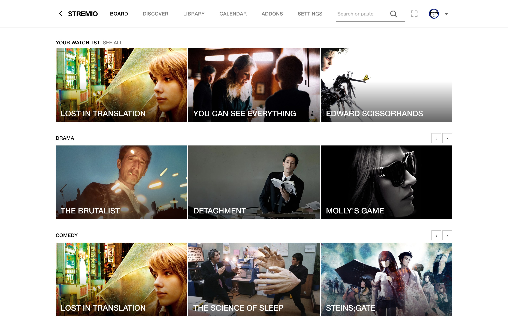
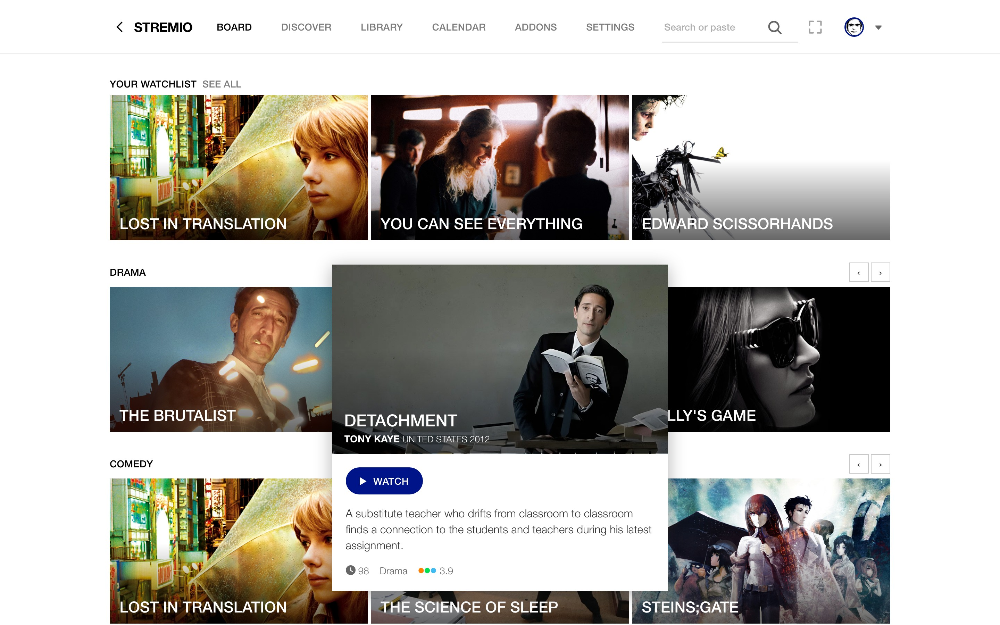
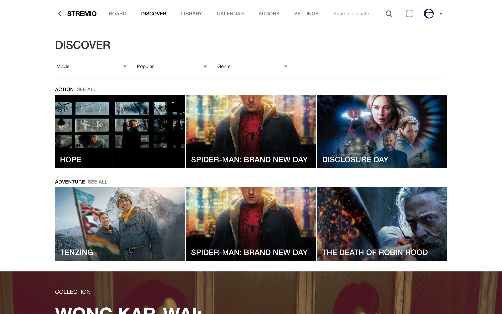
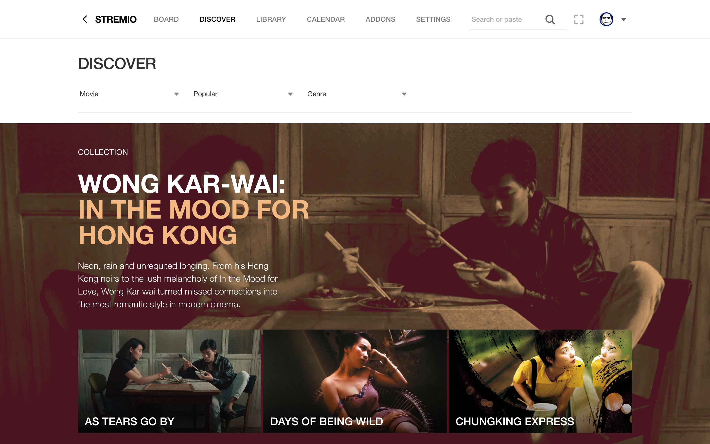
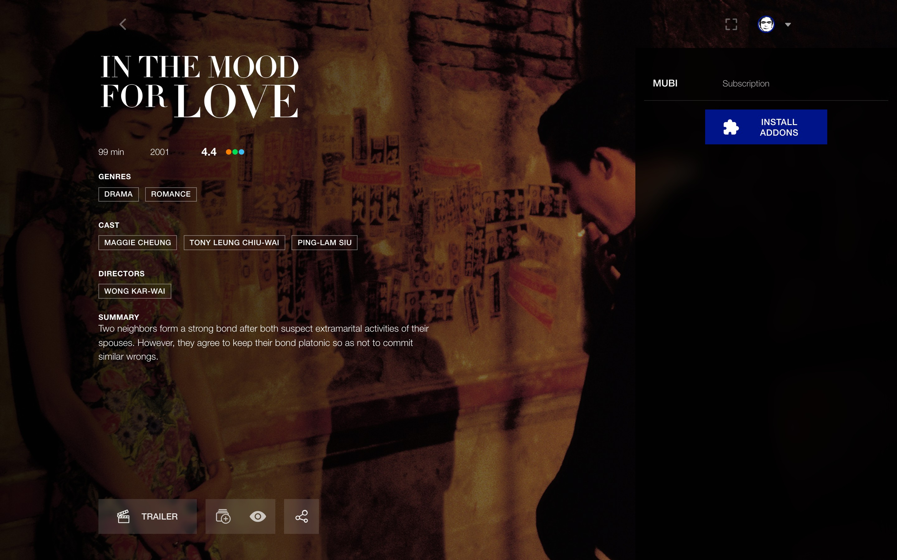
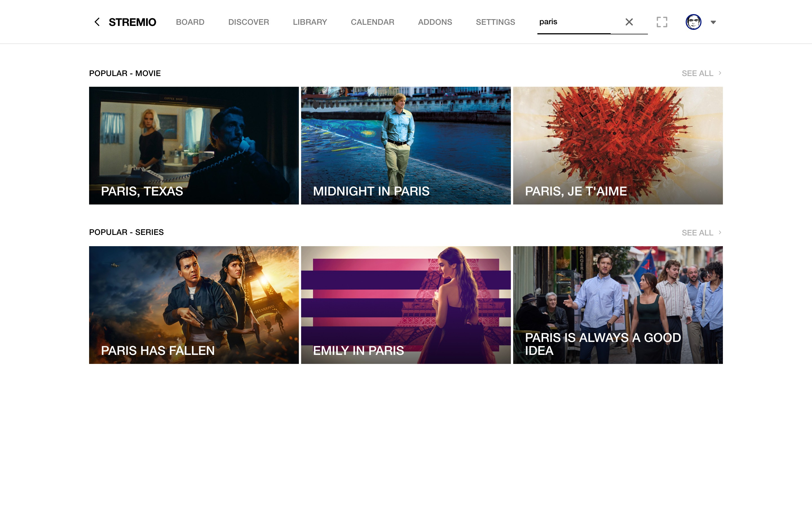
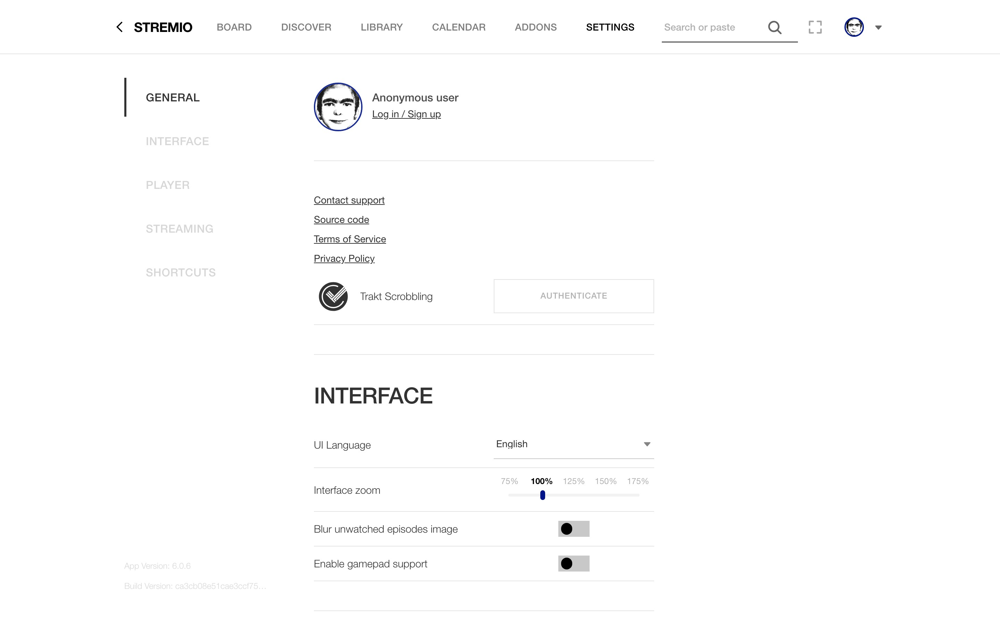

# StremioMUBI

A theme and a set of plugins for [Stremio Enhanced](https://github.com/REVENGE977/stremio-enhanced) that make Stremio look and feel like [MUBI](https://mubi.com): white editorial pages, widescreen film stills, uppercase type, MUBI blue, hover cards, curated collections, and your Letterboxd watchlist and ratings.

Unofficial fan project, not affiliated with MUBI, Stremio or Letterboxd.



| | |
|---|---|
|  |  |
|  |  |
|  |  |

## What's included

| File | What it does |
|---|---|
| `mubi.theme.css` | The look, on every screen: board, search, discover, library, calendar, film page, add-ons, settings, login, menus and player. |
| `mubi-stills.plugin.js` | Swaps portrait posters for widescreen film stills, like MUBI's tiles. |
| `mubi-hover.plugin.js` | MUBI's hover card: rest on a film to get a bigger still, a blue WATCH button, the synopsis, director, country, year, runtime, genres and rating. |
| `mubi-rows.plugin.js` | The Board becomes Continue Watching plus your Letterboxd watchlist, one row per genre. Discover shows one row per genre, with collection banners in between; picking a genre brings back the normal grid. |
| `mubi-collections.plugin.js` | Draws the curated collections as MUBI's collection blocks: duotone still, big title, synopsis, films below. |
| `mubi-letterboxd-rating.plugin.js` | Replaces the IMDb rating with the film's Letterboxd average, linking to its Letterboxd page. |
| `mubi-navigation.plugin.js` | A back arrow in the top bar, plus back/forward with Cmd+[ / Cmd+], Cmd+← / Cmd+→, mouse side buttons and a two-finger swipe. |
| `collections.json` | The curated collections: Wong Kar-wai, Iñárritu, David Lynch, recent Palme d'Or winners, Kieślowski's Three Colours and the Before trilogy. |

## Install

The official Stremio app can't load themes or plugins, so this runs on **Stremio Enhanced**, a community Stremio client. It uses your normal Stremio account, library and add-ons.

### 1. Install Stremio Enhanced

1. Open the Stremio Enhanced [releases page](https://github.com/REVENGE977/stremio-enhanced/releases) and download the latest **stable** release (the newest ones may be Windows-only previews):
   - **Mac with Apple Silicon (M1 and later):** `Stremio.Enhanced-<version>-arm64.dmg`
   - **Mac with Intel:** `Stremio.Enhanced-<version>.dmg`
   - **Windows:** `Stremio.Enhanced.Setup.<version>.exe`
   - **Linux:** the `.AppImage`
2. **macOS only:** the app isn't signed, so macOS may say it's damaged or can't be opened. After moving it to Applications, run:
   ```bash
   xattr -cr "/Applications/Stremio Enhanced.app"
   ```
3. Open it and sign in with your Stremio account.

### 2. Install Stremio Service (needed to play most streams)

Stremio Enhanced needs Stremio's streaming server running in the background. Without it, most files (MKV, x265, debrid links) fail with "Video is not supported".

- Download it from the [Stremio Service releases](https://github.com/Stremio/stremio-service/releases) (`StremioService.dmg` on Mac; on Windows `winget install Stremio.StremioService` also works), install it and open it. It lives in the menu bar / system tray.
- On macOS, if it won't open: `xattr -cr "/Applications/StremioService.app"`
- Check it under **Settings → Streaming** in Stremio Enhanced: the streaming server should show as online.

### 3. Add the theme and plugins

1. Download `mubi.theme.css` and the six `.plugin.js` files from this repo (or clone it).
2. **Set your Letterboxd username:** open `mubi-rows.plugin.js` in a text editor and change `LETTERBOXD_USER` near the top to your Letterboxd username. Your watchlist has to be public (Letterboxd → Settings → Privacy).
3. In Stremio Enhanced, go to **Settings**, scroll to the bottom and click **Open Themes Folder**. Put `mubi.theme.css` there.
4. Click **Open Plugins Folder** and put the six `.plugin.js` files there.
5. Quit Stremio Enhanced completely and open it again.
6. In **Settings**, apply the **MUBI** theme and enable the six **MUBI** plugins.

### 4. Optional add-ons

- **Stremboxd** (recommended): configure it at [stremboxd.com/configure](https://stremboxd.com/configure) with *Username only* and install it. The Board works without it, but it powers the **See all** link on *Your watchlist*.
- **MUBI Collections**: paste `https://jjjulianleon.github.io/StremioMUBI/manifest.json` into **Addons → Add addon**. Stremio Enhanced shows the collections without it; installing it also gives you the collections as catalogs on Stremio for phone or TV, where plugins don't run.

## Customising

### Collections

Edit `collections.json`: an `id`, a `title` and `subtitle` (the subtitle is drawn in the light colour), a `description`, two `colors` (dark, light) for the duotone, and the films as IMDb ids or IMDb links. Then rebuild the add-on and push:

```bash
python3 build_collections.py
```

Discover picks up the changes on its next load. If you installed the MUBI Collections add-on, reinstall it after adding a new collection, because Stremio caches the list of catalogs.

### Profile picture

The theme replaces Stremio's cat avatar with a custom image, embedded in `mubi.theme.css` under "Profile picture". Delete that block to keep Stremio's avatar, or replace the data URL with your own image:

```bash
base64 -i your-image.webp | tr -d '\n'
```

Paste the output after `data:image/webp;base64,` (use `image/png` or `image/jpeg` for those formats).

## How it works

- **Watchlist:** read from Stremboxd's public API with your username (no password), grouped by genre and cached on your computer, so the Board opens instantly and refreshes in the background.
- **Letterboxd ratings:** read straight from letterboxd.com and cached for a week. This works because Stremio Enhanced turns off the browser's cross-site checks; it wouldn't in a regular browser.
- **Stills:** come from the same image service Stremio uses for posters (metahub), so they match what Stremio already knows about each film.

## Known limits

- MUBI's font (Riforma) is licensed, so the theme uses Helvetica Neue, which is MUBI's own fallback.
- Stremio Enhanced's player is browser-based: Dolby Vision, some 4K HDR remuxes and TrueHD audio may fail to play. Pick a 1080p WEB-DL, or set an external player (VLC, IINA) under **Settings → Player**.
- The hover card shows a still, not a trailer, and has no watchlist or favourite buttons.
- Stremio updates can rename parts of its interface. If something stops matching, open an issue with a screenshot.
